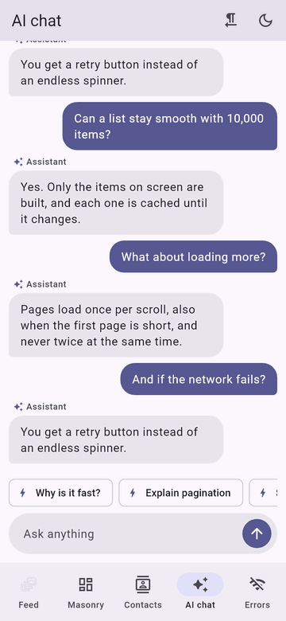
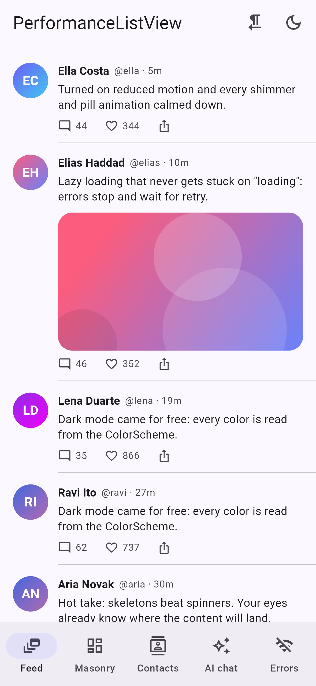
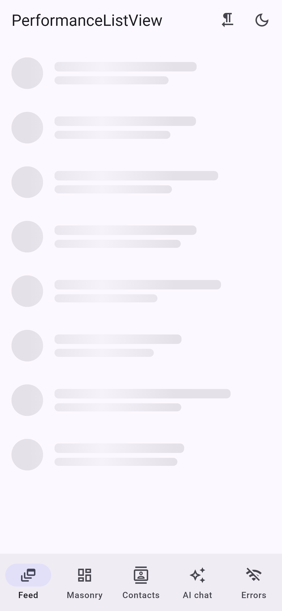
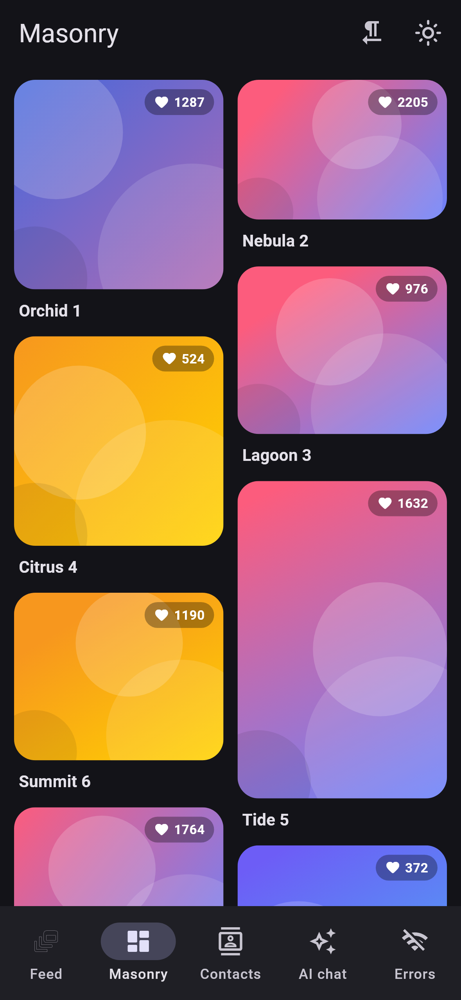
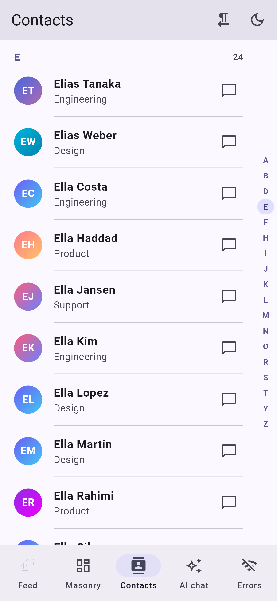
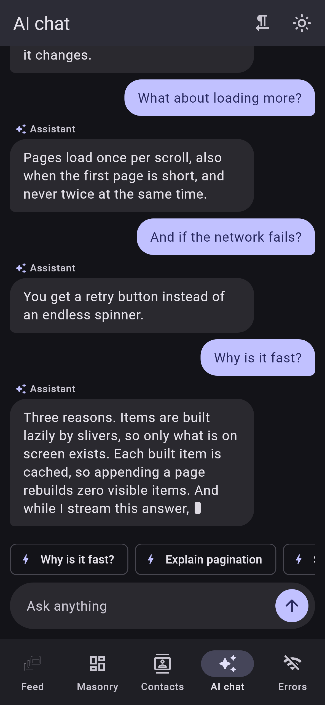
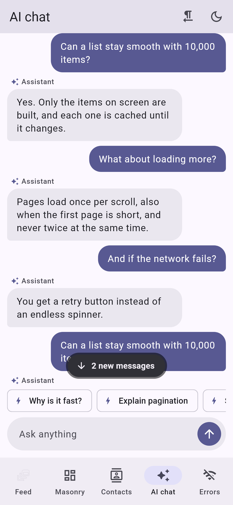
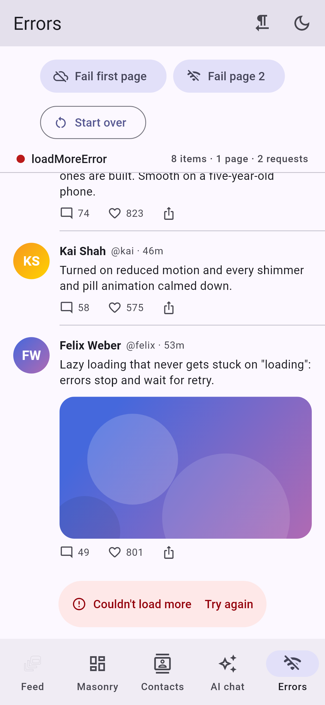
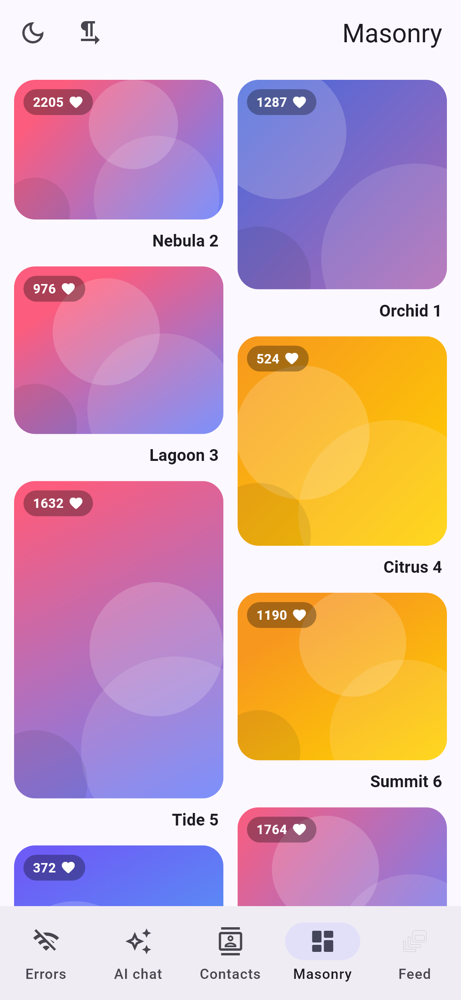
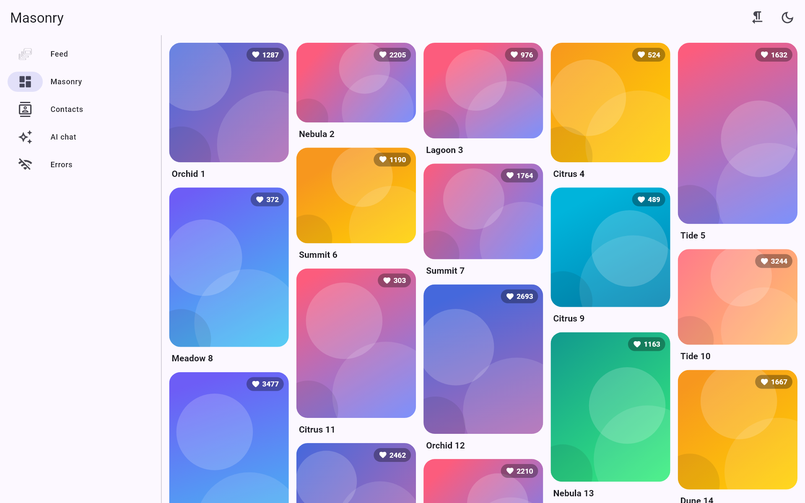

# ⚡ PerformanceListView

[](https://pub.dev/packages/performance_list_view)
[](LICENSE)
[](https://pub.dev/packages/performance_list_view)

Fast Flutter lists, grids and masonry grids with **pagination that never gets stuck**, pull-to-refresh, sticky headers, shimmer skeletons, animated changes, scroll-to-index, and a **chat / AI streaming view**. Pure Flutter, no dependencies.

<p align="center">
  
</p>

<p align="center">
  
  
  
  
</p>
<p align="center">
  
  
  
  
</p>
<p align="center">
  
</p>

## Features

| | |
|---|---|
| **Pagination that never gets stuck** | One load at a time, also when the first page is shorter than the screen. Stale pages after a refresh are dropped, errors wait for retry, empty pages end the list, `fetchTimeout` ends hung requests. |
| **Zero rebuilds on append** | Built items are cached: loading a page rebuilds none of the items on screen, and updating one item rebuilds only that one. |
| **Page or cursor APIs** | `PagingController.byPage`, `PagingController.byCursor`, or any key type with `PageResult`. `refresh()`, `retry()`, `reset()`, prepend and in-place updates. |
| **Layouts** | List (with `itemExtent` / `prototypeItem` fast paths), grid, lazy **masonry**, separators, horizontal, reverse. |
| **Sticky section headers** | `PerformanceSections` groups consecutive items; headers pin and push each other. |
| **Chat & AI streaming** | `PerformanceChatView` stays pinned while a reply streams in, never moves what you are reading, shows a jump-to-latest pill with an unread count and loads older history. `StreamingText` rebuilds one bubble per token. |
| **Skeletons & states** | Shimmer skeletons in the shape of your layout, default empty, error, loading and "all caught up" views, all replaceable. |
| **Scroll to index** | `controller.scrollToIndex(i)` reaches items that are not built yet, even with varying heights, grids and sections. |
| **Animated changes** | `animateChanges: true` animates inserts and removals made through the controller. |
| **State that follows items** | `itemKey` (or the keys your builder returns) keeps item state across inserts above it. |
| **Themes** | Every color comes from the `ColorScheme`, light and dark. Override through the `PerformanceListThemeData` theme extension; replace texts for localization. |
| **Accessible** | Semantic item counts, labeled buttons, live-region footers, RTL, reduced motion. |
| **Everywhere** | Pure Flutter: Android, iOS, web, macOS, Windows, Linux. |

## Quick start

```yaml
dependencies:
  performance_list_view: ^1.0.0
```

```dart
import 'package:performance_list_view/performance_list_view.dart';

final posts = PagingController.byPage<Post>(
  pageSize: 20,
  fetch: (page, size) => api.posts(page: page, limit: size),
);

PerformanceListView<Post>(
  listController: posts,
  itemKey: (post) => post.id,
  itemBuilder: (context, post, index) => PostTile(post),
);
```

That is the whole infinite feed: skeletons on first load, pull-to-refresh, a loading footer, an error footer with retry, and an "all caught up" footer after the last page. Dispose the controller with its owner.

## Pagination recipe

Any key type works. Return a `PageResult` with the next key, or none after the last page:

```dart
final controller = PagingController<String?, Order>(
  firstPageKey: null,
  fetchTimeout: const Duration(seconds: 15),
  fetchPage: (cursor) async {
    final res = await api.orders(after: cursor);
    return PageResult(res.items, nextPageKey: res.nextCursor, isLastPage: res.nextCursor == null);
  },
);

// Elsewhere:
await controller.refresh();          // pull-to-refresh calls this for you
controller.retry();                  // after firstPageError / loadMoreError
controller.prepend(newOrder);        // a pushed update; only it builds
controller.updateWhere((o) => o.id == id, (o) => o.copyWith(paid: true));
controller.scrollToIndex(42);
```

What the controller guarantees:

* only one load runs at a time; `loadMore()` during a load returns the running one;
* a page that arrives after `refresh()`, `reset()` or `dispose()` is dropped;
* a thrown error or a timeout ends in `PagingStatus.firstPageError` or `loadMoreError`, never in an endless spinner, and nothing loads again until `retry()`;
* an empty page pointing at the same key ends the list instead of looping;
* concurrent `refresh()` calls share one request, and a failed refresh keeps the old items (`refreshError`).

Already manage state yourself? The 0.x props still work, with the same guards:

```dart
PerformanceListView<Post>(
  items: state.posts,
  isLoading: state.loading,
  hasError: state.error != null,
  hasMore: state.hasMore,
  onEndReached: bloc.loadMore,   // called once per load; a returned Future is awaited
  onRetry: bloc.retry,
  onRefresh: bloc.refresh,
  itemBuilder: (context, post, _) => PostTile(post),
);
```

## Chat / AI recipe

Messages are newest first; index 0 is the bottom. Give the streaming reply a `StreamingTextController` and bind it to your model's token stream:

```dart
final messages = PerformanceListController<Message>();
final typing = ValueNotifier(false);

PerformanceChatView<Message>(
  controller: messages,
  typing: typing,
  itemKey: (m) => m.id,
  itemBuilder: (context, m, _) => ChatBubble(
    isUser: m.fromUser,
    child: m.reply == null ? Text(m.text) : StreamingText(controller: m.reply!),
  ),
);

Future<void> ask(String prompt) async {
  messages.prepend(Message.user(prompt));
  typing.value = true;
  final tokens = model.stream(prompt);          // Stream<String>
  final reply = StreamingTextController();
  typing.value = false;
  messages.prepend(Message.assistant(reply));
  await reply.bind(tokens);                     // completes with the stream
}
```

* While pinned at the bottom, new messages, the growing reply and the typing indicator stay in view in the same frame.
* Scrolled up, nothing you read moves: new content grows below a fixed anchor, and the **jump to latest** pill counts what arrived.
* Each token rebuilds only that bubble's text. No other message is rebuilt.
* With a `PagingController`, older history loads as you scroll up.

## More

```dart
// Masonry grid, columns follow the width
PerformanceListView<Photo>.masonry(
  listController: photos,
  maxCrossAxisExtent: 240,
  mainAxisSpacing: 12,
  crossAxisSpacing: 12,
  itemBuilder: (context, photo, _) => PhotoCard(photo),
);

// Sticky headers and separators
PerformanceListView<Contact>(
  items: contacts,
  sections: PerformanceSections<Contact, String>(
    sectionOf: (c) => c.name[0],
    headerBuilder: (context, letter, _) => PerformanceSectionHeader(title: letter),
  ),
  separatorBuilder: (context, _) => const Divider(height: 1),
  itemBuilder: (context, c, _) => ContactTile(c),
);

// Animated inserts and removals
PerformanceListView<Task>(listController: tasks, animateChanges: true, itemBuilder: ...);

// Theme
ThemeData(extensions: const [
  PerformanceListThemeData(
    skeletonRadius: 14,
    texts: PerformanceListTexts(endOfList: 'Fin', retry: 'Réessayer'),
  ),
]);
```

## Benchmark

`test/benchmark_test.dart` times every frame (build + layout + paint) against a plain `ListView.builder` and counts item builds. Same item widget, 400 × 800 viewport, 7 rounds, median round. Flutter 3.47 widget tests run in debug (JIT) mode, so compare the rows rather than the absolute numbers with a device.

| Scenario | Mean ms / frame | p50 | p90 | Item builds |
|---|---:|---:|---:|---:|
| Scroll 10,000 items: `ListView.builder` | 1.80 | 1.30 | 2.84 | 250 |
| Scroll 10,000 items: `PerformanceListView` | 1.90 | 1.44 | 3.11 | 250 |
| Scroll, `itemExtent: 72`: `ListView.builder` | 1.83 | 1.31 | 2.76 | 250 |
| Scroll, `itemExtent: 72`: `PerformanceListView` | 1.83 | 1.33 | 3.33 | 250 |
| Append 60 pages of 20: `ListView.builder` + `setState` | 3.71 | 3.32 | 5.10 | 900 |
| Append 60 pages of 20: `PerformanceListView` + controller | **1.07** | **0.98** | **1.18** | **0** |
| Stream 400 tokens into a 200-message chat: `ListView.builder` + `setState` | 2.50 | 2.21 | 3.69 | 1,124 |
| Stream 400 tokens: `PerformanceChatView` + `StreamingText` | **1.78** | **1.57** | **2.63** | **0** |

* **Scrolling** builds exactly the same items as `ListView.builder`, at the same cost within about 5% (the extra work is the bookkeeping that makes the rows below possible). With `itemExtent` they are even.
* **Appending a page** is 3.5× cheaper per frame: zero visible items rebuild, against 900 with `setState` + `ListView.builder`.
* **Streaming an AI reply** is 1.4× cheaper per token: zero items rebuild, against 1,124 with `setState`, and the bottom stays pinned without a scroll jump.

```bash
flutter test test/benchmark_test.dart --dart-define=BENCH=true
```

## Parameters

`PerformanceListView` (also `.grid` and `.masonry`):

| Parameter | Default | |
|---|---|---|
| `listController` | — | A `PagingController` or `PerformanceListController`. Takes precedence over `items`. |
| `items` | `[]` | A plain list, with the 0.x props below. |
| `itemBuilder` | required | `(context, item, index)`. Returning null shows nothing for that item. |
| `itemKey` | — | Stable identity, so item state follows inserts and removals. |
| `onEndReached`, `isLoading`, `hasError`, `hasMore`, `error`, `onRetry` | | Pagination with `items`. |
| `onRefresh`, `pullToRefresh` | —, `true` | Pull-to-refresh. Defaults to `controller.refresh` with a `PagingController`. |
| `emptyBuilder`, `loadingBuilder`, `errorBuilder`, `bottomLoaderBuilder`, `endOfListBuilder` | defaults | State widgets. |
| `firstPageErrorBuilder`, `loadMoreErrorBuilder` | defaults | Error widgets with the error and a retry callback. |
| `skeletonBuilder`, `skeletonCount` | shimmer, `8` | First-load placeholders. |
| `separatorBuilder` | — | List separators. |
| `sections` | — | Sticky section headers. |
| `itemExtent`, `prototypeItem` | — | Fixed-extent fast paths. |
| `scrollThreshold`, `loadMoreExtent`, `loadMoreDebounce` | `3`, 60% of viewport, `0` | When to load the next page. |
| `cacheExtent`, `scrollCacheExtent` | Flutter's | How much to build ahead. |
| `addRepaintBoundaries`, `addAutomaticKeepAlives`, `addSemanticIndexes` | `true` | Per-item wrappers. |
| `animateChanges`, `animationDuration`, `itemTransitionBuilder` | `false`, 280 ms, size + fade | Animated inserts and removals. |
| `controller`, `physics`, `padding`, `headerSlivers`, `footerSlivers`, `scrollDirection`, `reverse`, `shrinkWrap`, `keyboardDismissBehavior`, `clipBehavior`, `restorationId` | | As in `CustomScrollView`. |
| `.grid(gridDelegate:)` | | Any `SliverGridDelegate`. |
| `.masonry(crossAxisCount: \| maxCrossAxisExtent:, mainAxisSpacing:, crossAxisSpacing:)` | | Staggered grid. |

`PerformanceChatView`: `controller`, `itemBuilder`, `itemKey`, `scrollController` (`ChatScrollController`), `typing`, `typingBuilder`, `showJumpToLatest`, `jumpToLatestBuilder`, `jumpToLatestThreshold`, `emptyBuilder`, `historyLoaderBuilder`, `historyErrorBuilder`, `historyStartBuilder`, `padding`.

## Migrating from 0.x

0.x code compiles unchanged. Behavior changes, all intentional:

* `onEndReached` is called once per load instead of once per built item, and for an empty list too (to load the first page). Set `hasMore: false` when there is no more data.
* A load-more error shows a footer with retry; `errorBuilder` is only the full-screen first-page error.
* `addAutomaticKeepAlives` now works as in Flutter: items that use `AutomaticKeepAliveClientMixin` stay alive, others are disposed off screen.
* `onRefresh` is optional, and the default physics follow the platform instead of bouncing everywhere.
* `PerformanceImage` no longer depends on `cached_network_image`. Its parameters are the same; for a disk cache pass `imageProvider: CachedNetworkImageProvider(url)`.

## Example

The [example](example) is a gallery that adapts from phone to desktop: infinite feed, masonry, sticky contacts with an A–Z index, AI chat streaming and an error lab.

```bash
cd example
flutter run -d chrome
```

## License

MIT
